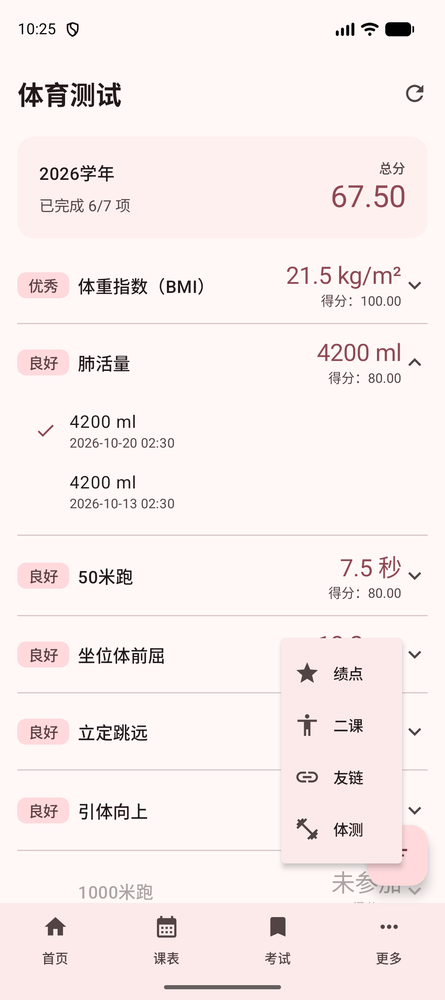
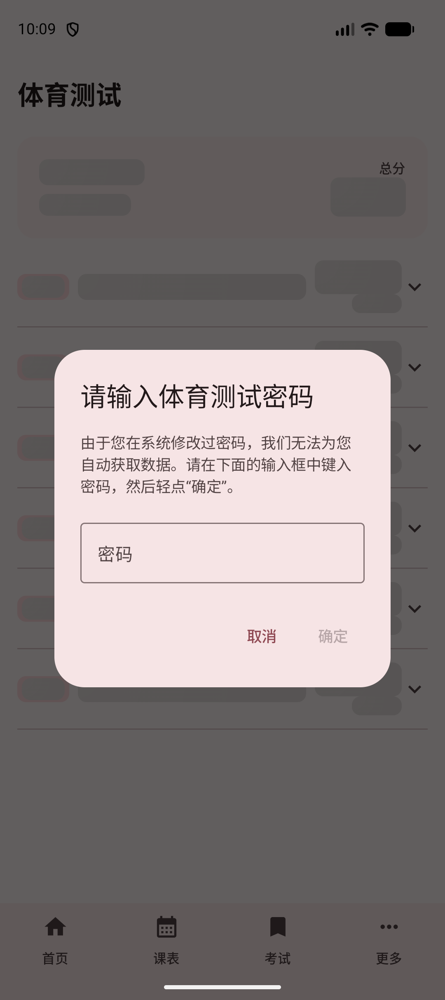
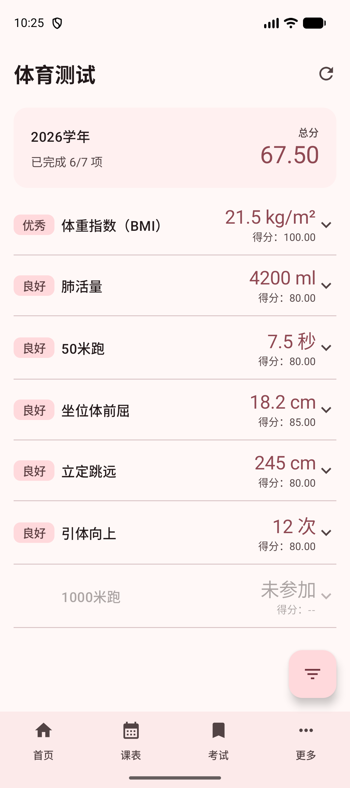
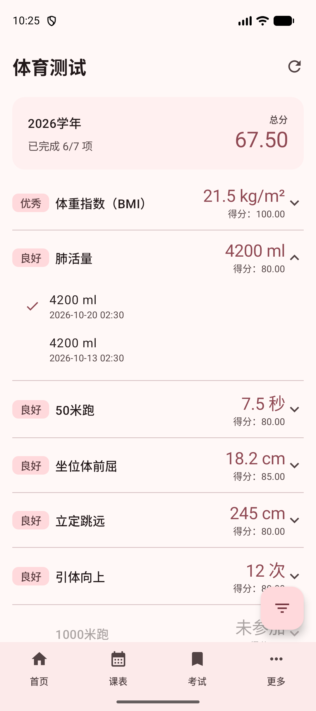
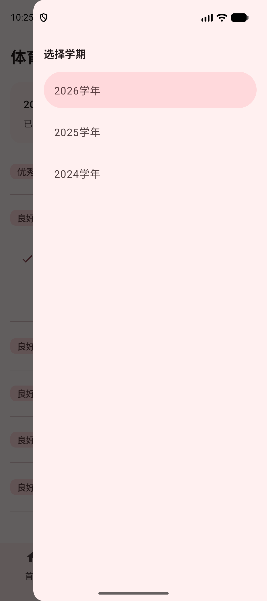

# 体育测试

体育测试页面用于查看学校体测系统中的体测成绩。应用会直接访问体测系统，把每个学年的总分、各测试项目的成绩与得分，以及同一项目的历史记录取回来，并保存到本地。

::: info

体测使用的是学校体测系统，和教务网不是同一个密码。账号仍用你的学号，但密码需要单独确认。

:::

## 进入体育测试

在首页底部导航中找到“体测”并进入。如果底部导航里没有这一项，可以点“更多”，在菜单中找到“体测”。

第一次进入时，页面会依次显示几条操作指引，说明刷新、筛选和项目列表分别在哪里。

## 体测密码

体育测试默认密码为 `111111`，EOA 会默认使用此密码登录你的体测系统。

如果你在体测系统中修改过密码，应用就无法再用默认密码自动获取数据，这时会弹出下面的对话框。

只需在输入框中键入你的体测密码，然后轻点“确定”即可。

点击“取消”会结束这次获取；如果页面停在“体育测试加载失败”，轻点页面可以重新输入密码。

登录成功后，密码会保存在本地，下次进入不需要重复填写；退出登录时会被一起清除。

## 学年总分

页面顶部是当前学年的概览卡片。

卡片左侧显示学年，以及“已完成 6/7 项”这样的完成情况，右侧显示这一学年的总分。

列表中的每个项目通常会显示：

- 评价标签，例如优秀、良好、及格
- 项目名称
- 测试成绩与单位
- 这一项的得分

没有参加的项目会变灰，成绩位置显示“未参加”，得分显示“得分：--”。

## 测试项目与历史记录

点击任意一个项目，可以展开这一项目的历史记录。

每条记录会显示测量值和录入时间。已被系统采用的记录，左侧会有一个对勾标记；如果这一项目没有历史记录，会提示“暂无历史记录”。

再次点击项目即可收起。

## 切换学年

页面右下角的“筛选”按钮用于切换要查看的学年。

打开后是一份学年列表（标题显示为“选择学期”），点击其中一项即可切换到对应学年，页面会重新显示这一学年的总分和项目列表。

刷新数据时会尽量保留当前选中的学年。

## 刷新数据

页面右上角的刷新按钮用于重新从体测系统获取数据。刷新过程中图标会持续旋转，此时不能再次点击刷新。

打开页面时，应用会先显示本地保存的上一次结果，再自动尝试刷新；刷新失败时会保留上一次成功获取的数据。

如果体测系统中还没有可显示的内容，页面会提示“暂无体育测试数据”，轻点右上角刷新按钮重新获取；某个学年没有项目时，列表会提示“暂无测试项目”。

## 常见情况

一直弹出密码对话框：说明默认密码没能登录成功。请确认体测系统中的当前密码；如果刚刚改过密码，填入新密码即可。

提示“已取消登录，点击页面重新登录”：你在密码对话框中点击了“取消”。轻点页面可以重新输入密码。

刷新后提示“数据获取失败，详情请查看日志”：可能是网络异常或体测系统暂时不可用。可以稍后重新刷新，详细原因可在[设置](./settings.md#进入设置)的“高级”中查看“系统日志”。

刷新后数据没有变化：应用显示的是体测系统当前返回的数据，新的成绩需要先在体测系统中录入。

数据和学校页面不完全一致：应用内数据来自体测系统接口，正式认定请以学校体测系统显示为准。
